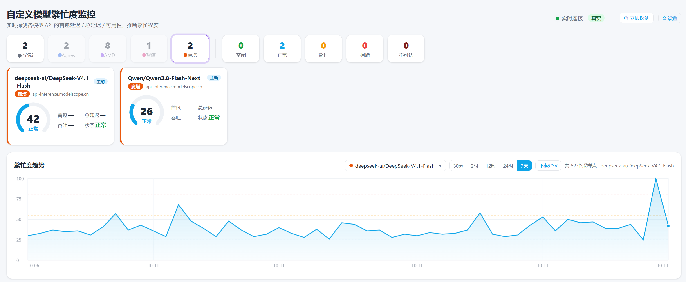

# model-monitor

自定义模型繁忙度监控 —— 零依赖 Node 后端 + 纯 HTML/JS 前端仪表盘。

## 预览

仪表盘实时显示各模型的首包延迟 / 总延迟 / 繁忙度评分，并绘制 7 天繁忙度趋势曲线（见 `docs/screenshot.png`）：



## 功能

- **主动探测**：定时（15~20 分钟随机抖动）对每个模型发流式 chat 补全，测量首包延迟（TTFT）/ 总延迟 / 可用性，并读取响应头限流信号（`x-ratelimit-remaining`、`retry-after`、HTTP 429/503）。
- **被动观测**：真实调用后通过 `POST /api/observe` 上报延迟/错误，零额外请求。两者共同推断繁忙度。
- **多模型管理**：仪表盘设置页增删改模型，改动即时写 `config.json` 并立即探测验证。
- **历史回看**：CSV 落盘，进程重启后保留近 30 天。

## 快速开始

### 1. 克隆仓库

```bash
git clone https://github.com/Turkeytp/model-monitor.git
cd model-monitor
```

> 仓库已改为 Public，可匿名直接 clone，无需令牌。
> 若本机走代理且 git 报 TLS 错误，临时指代理：`git config --global http.proxy http://127.0.0.1:你的代理端口`，或 `git -c http.proxy= clone ...` 直连。

### 2. 构建镜像

```bash
docker build -t model-monitor:latest .
```

（`.dockerignore` 已排除含 Key 的 `config.json` 与 `data/`，构建不会带入任何敏感数据。）

### 3. 运行容器

```bash
# 最简：
docker run -d -p 8080:8080 model-monitor:latest

# 推荐（鉴权 + 持久化历史 + 自定义配置）:
docker run -d -p 8080:8080 \
  -e PORT=8080 \
  -e ACCESS_TOKEN=你的访问令牌 \
  -v $(pwd)/data:/app/data \
  -v $(pwd)/config.json:/app/config.json \
  model-monitor:latest
```

参数说明：

| 参数 | 作用 |
|---|---|
| `-p 8080:8080` | 映射仪表盘端口 |
| `-e PORT=8080` | 容器内监听端口 |
| `-e ACCESS_TOKEN=...` | 启用 `/api/*` 访问鉴权（不设则局域网开放访问） |
| `-v .../data:/app/data` | 持久化 30 天探测历史 CSV |
| `-v .../config.json:/app/config.json` | 注入你的模型配置（含 API Key，切勿打进镜像） |

浏览器打开 `http://<主机>:8080/` 即可看到仪表盘；设置页在 `http://<主机>:8080/settings`。

### 4. 配置要监控的模型

两种方式（二选一）：

- **网页端**：打开 `http://<host>:8080/settings`，填模型 `id` / 厂商 / 接口地址 / API Key，点「保存」即时写入 `config.json` 并立即探测。
- **文件端**：直接编辑挂载的 `config.json`（重启容器生效），结构：

```json
{
  "models": [
    {
      "id": "DeepSeek-V4-Flash",
      "name": "DeepSeek-V4-Flash",
      "vendor": "DeepSeek",
      "url": "https://api-inference.modelscope.cn/v1",
      "apiKey": "sk-你的Key"
    }
  ]
}
```

### 5. （可选）被动观测接入

真实调用模型后，在你的代码里引入 `app/public/passive-client.js` 上报延迟，让仪表盘反映真实体验：

```html
<script src="http://<监控服务IP>:8080/passive-client.js"></script>
<script>
  // 调用完成后:
  observeModel('DeepSeek-V4-Flash', { ttftMs: 320, totalMs: 980, status: 200 });
</script>
```

## 安全

- 明文 API Key **永不返回**给前端/外网（`/api/models` 仅返回尾 4 位掩码）。
- `config.json` / `data/` 为运行期数据，由 `.dockerignore` + `.gitignore` 排除，**绝不进镜像、绝不进仓库**。
- 公网部署务必设置 `ACCESS_TOKEN` 与 `ALLOWED_ORIGINS`（CORS 白名单），避免匿名写 `/api/observe` 注入脏数据。
